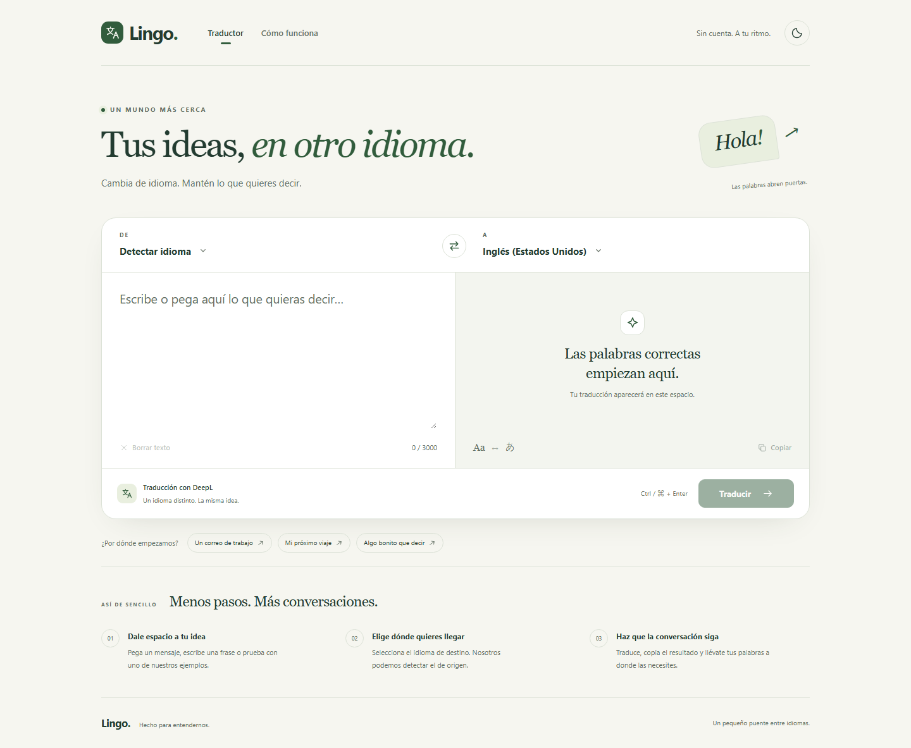

# Lingo

Aplicación web de traducción en construcción por fases y commits pequeños.

Repositorio: https://github.com/Angel17jc/Lingo

## Estado

Fases 1 y 2 completadas e integradas en develop. Fase 3: interfaz del traductor lista para revisión, con modo claro/oscuro, controles accesibles y diseño responsive. Consulta el [registro de avances](docs/avance.md) y la [guía original](docs/traductor-guia-completa.md).

## Instalación local

Requisitos: Node.js 22.13 o superior (se verificó con Node 24) y pnpm. La versión de pnpm está fijada en package.json.

```powershell
npm install --global pnpm
pnpm install --frozen-lockfile
Copy-Item .env.example .env.local
```

Completa .env.local con tus credenciales antes de arrancar. No las pegues en el chat ni las subas al repositorio.

| Variable                 | Uso                                                             |
| ------------------------ | --------------------------------------------------------------- |
| TRANSLATION_PROVIDER     | deepl por defecto; azure está reservado para una fase posterior |
| DEEPL_API_KEY            | Clave del proveedor DeepL                                       |
| DATABASE_URL             | URL PostgreSQL pooled de Neon                                   |
| UPSTASH_REDIS_REST_URL   | URL HTTPS de Redis REST                                         |
| UPSTASH_REDIS_REST_TOKEN | Token de Redis REST                                             |

Las variables se validan con Zod en el servidor al cargar la aplicación. Se requieren todas para respetar el contrato de configuración. El endpoint contacta DeepL al recibir una solicitud válida; Neon y Redis todavía no se utilizan. Los errores de configuración solo enumeran los nombres de las variables incorrectas.

## Comandos

```powershell
pnpm dev
pnpm typecheck
pnpm lint
pnpm format:check
pnpm test
pnpm build
pnpm start
```

Si PowerShell bloquea pnpm.ps1, usa pnpm.cmd en los comandos (por ejemplo, pnpm.cmd dev), sin cambiar la política de ejecución. La aplicación se abre en http://localhost:3000. El hook de pre-commit aplica ESLint y Prettier sobre los archivos preparados.

Vitest está configurado con entorno Node y alias @. Ejecuta pnpm test para las pruebas de configuración, contratos, errores, proveedores, servicio y API. Las pruebas de DeepL simulan la red y el tiempo, sin gastar cuota. Se adelantaron los e2e de la fase 6 para verificar la interfaz; se ejecutan en local y simulan la API.

## Arquitectura

- src/app: presentación y rutas de Next.js.
- src/features/translator: componentes, hooks y esquemas compartidos.
- src/server: servicios, proveedores, caché y base de datos.
- src/lib: configuración de servidor, catálogo de idiomas y logger.
- src/tests: pruebas unitarias de configuración y contratos de traducción.

La presentación dependerá de los servicios; los servicios dependerán de interfaces para permitir cambiar de proveedor. El adaptador DeepL está conectado al servicio y a la API. La ruta depende del servicio; la lógica del servicio usa interfaces y su composición está separada. El formulario envía el texto a la API únicamente al pulsar Traducir o Ctrl/Cmd+Enter. El contrato de caché está reservado para la fase 4 y aún no hay conexiones a Neon o Redis.

El logger solo admite eventos conocidos y campos técnicos explícitos. No recibe texto de traducciones, claves ni objetos de error.

Las cabeceras de seguridad están en next.config.ts. La CSP inicial permite scripts inline para el arranque de Next.js; en desarrollo permite además eval y WebSockets. La política con nonce se revisará en la fase de calidad y despliegue.

Despliegue previsto en Vercel en la fase 6.

## Trabajo con issues y PRs

Seguimos CONTRIBUTING.md: issue → rama de tarea → PR a develop → PR de entrega a main. main se reserva para producción y develop para integración. El CI comprueba formato, lint, tipos, pruebas y build antes de fusionar cambios. Consulta la [guía de colaboración](CONTRIBUTING.md).

## Proveedores de traducción

TRANSLATION_PROVIDER=deepl selecciona DeepL API Free. La clave permanece en el servidor y se envía en la cabecera Authorization. El adaptador valida la respuesta, cancela cada intento a los 8 segundos y realiza un único reintento tras 300 ms ante fallos de red o 5xx.

TRANSLATION_PROVIDER=azure selecciona un stub todavía no implementado que devuelve un ProviderError controlado. No es un proveedor funcional.

Se mantiene el mapeo de 429/456 a cuota agotada de la guía de Lingo; la diferencia con la recomendación actual de DeepL está documentada en el registro de avances. El endpoint está implementado y la comprobación con una clave real pasó con origen explícito y autodetección. La suite unitaria y el CI siguen usando proveedores simulados.

## Probar la API

Completa .env.local con tus credenciales y ejecuta pnpm dev. Desde otra terminal PowerShell:

```powershell
$body = @{ text = "Hola mundo"; target = "EN-US" } | ConvertTo-Json
Invoke-RestMethod -Uri http://localhost:3000/api/translate -Method Post -ContentType "application/json" -Body $body
```

El origen se autodetecta al omitir source. La respuesta correcta contiene translation, detectedSource y cached: false. Opcionalmente envía source con un código de origen del catálogo.

Los errores tienen forma { error: { code, message, retryAfterSeconds? } }. La API devuelve 400 para solicitudes inválidas, 502 para fallos del proveedor, 503 para cuota agotada y 500 para fallos inesperados. El mapeo de 429 con Retry-After está preparado para el limitador de la fase 5; todavía no limita solicitudes.

Todas las respuestas POST llevan Cache-Control: no-store. La caché, la protección de cuota, el rate limiting y el límite de bytes del body se implementarán en sus fases. El límite de texto de 3000 unidades UTF-16 ya se valida con Zod.

La fase 2 está integrada y su checklist técnico está verificado. No publiques claves en el chat ni en GitHub.

## Usar el traductor

Elige el idioma de destino y escribe hasta 3000 caracteres. Puedes dejar la autodetección de origen. Pulsa Traducir o Ctrl/Cmd+Enter. Copia el resultado o intercambia los idiomas para continuar la conversación. Los ejemplos solo rellenan el campo y no envían solicitudes.

Editar el texto o cambiar los idiomas cancela la espera del cliente y limpia el resultado anterior. El intercambio reconoce EN-US/EN-GB como origen EN y PT-BR/PT-PT como origen PT; los destinos por defecto al volver a esas lenguas son EN-US y PT-BR.

El tema sigue inicialmente la preferencia del sistema; el botón de la cabecera permite cambiarlo y guarda solo esa preferencia. Los textos no se guardan en localStorage. Al traducir, se envían a DeepL.



[Vista móvil](docs/images/lingo-mobile.png) · [Modo oscuro](docs/images/lingo-dark.png)

## Comprobación en navegador

```powershell
pnpm exec playwright install chromium
pnpm build
pnpm e2e
```

Playwright abre el build de producción en 127.0.0.1:3100 y lo cierra al terminar. Las pruebas sustituyen /api/translate y usan Azure como stub de respaldo, con valores de entorno de prueba. No consumen cuota real ni requieren tus claves. El puerto 3100 debe estar libre.

Los nueve escenarios cubren traducción, teclado, anuncios del resultado, copia y su alternativa manual, intercambio, límites, cancelación, respuestas antiguas, errores, cuenta atrás, tema, contraste y tamaños móvil/escritorio. El CI conserva formato, lint, tipos, unitarios y build; los e2e se ejecutan en local.
